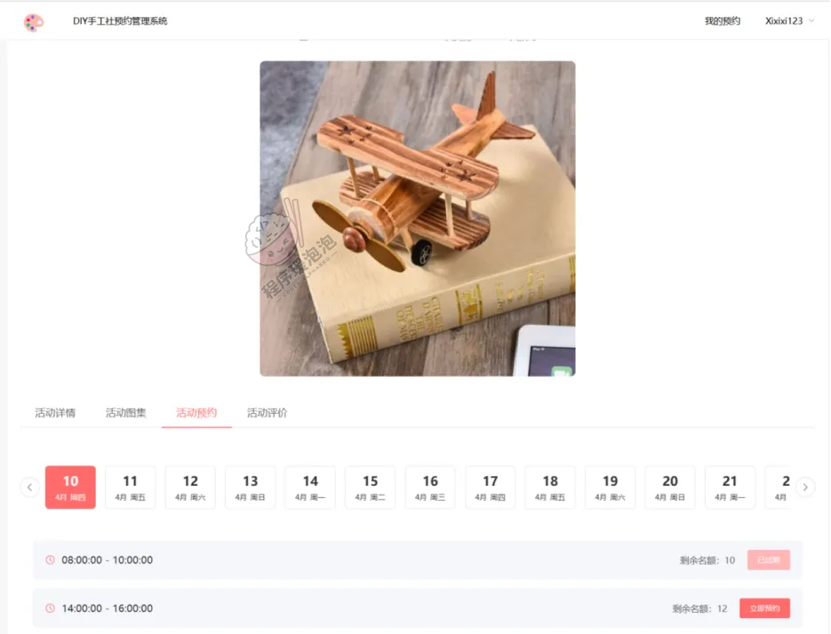
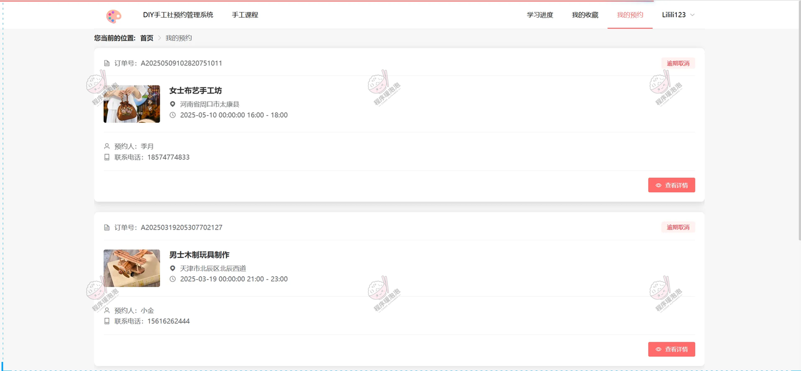
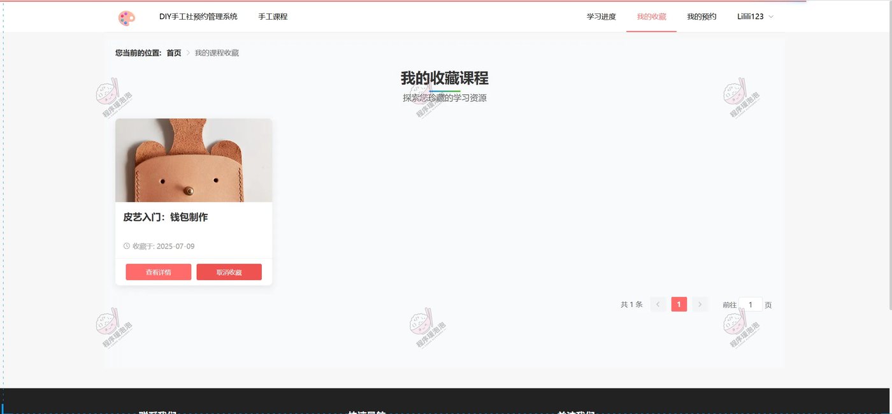
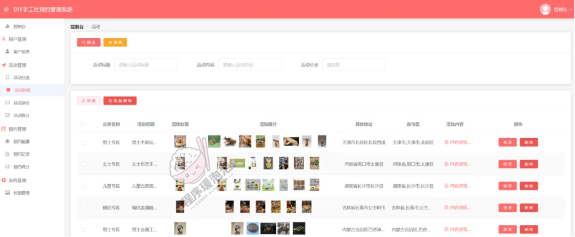
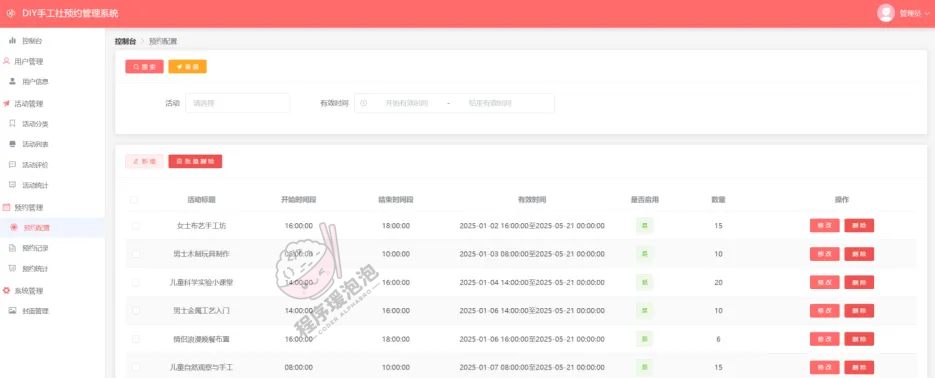
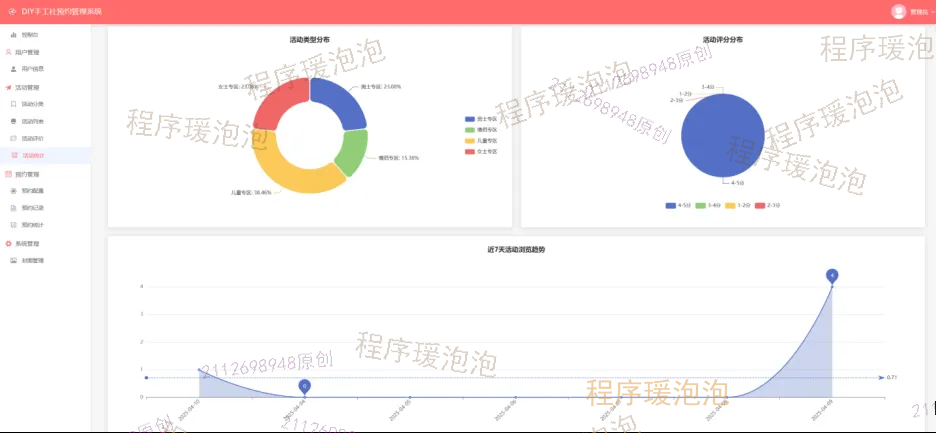
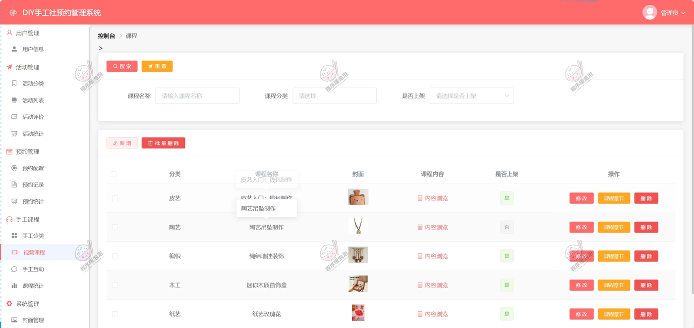
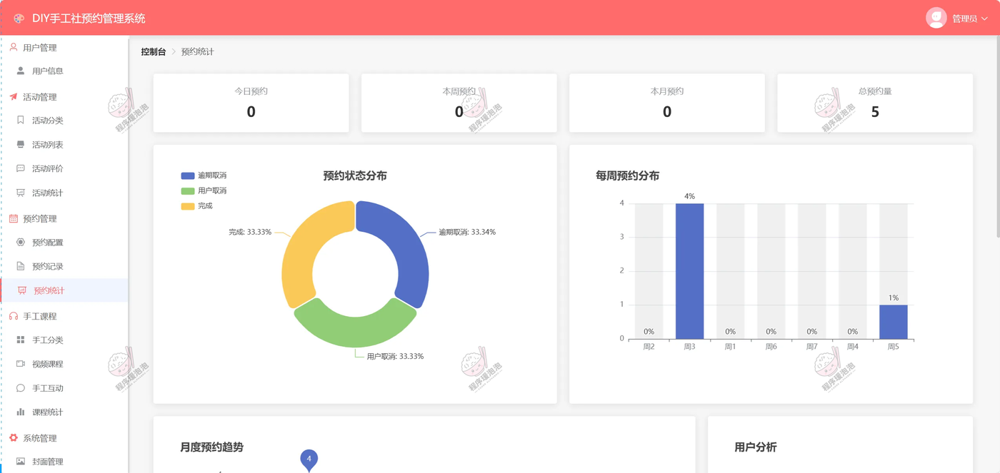
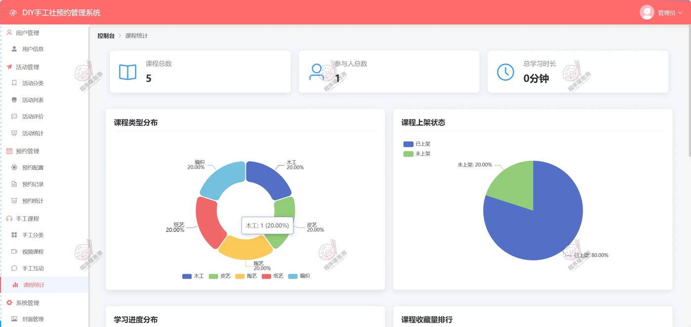

# diyappoint
DIY手工社预约管理系统
本文注重于计算机毕业设计选题指导，列出题目均有源码， 大家可以去【公众号】(毕业终点站)获取或者加我【qq】(2112698948)提意见(别忘记Star哟)。备注：git

声明：仅用于学习使用，请勿用于任何商业行为！

1.系统非商用，非开源，非无偿。

2.由本人开发，如需源码，请联系以下方式，qq:2112698948。个人网站： https://home.biyecode.com；

3.项目有很多，并未全部上传，如果未找到想要的，可直接咨询。

# DIY手工社预约管理系统

基于用户网页端 + 管理后台的手工社团活动预约系统，把手工活动的浏览预约、课程视频学习和数据统计分析放在一处。用户端面向社员，管理员端负责活动、预约、课程维护和多维度看板。

## 项目简介

- **架构**：B/S、MVC、前后端分离，用户网页端 + 管理后台，管理员与普通用户双角色
- **开发环境**：IDEA、JDK17、Maven、MySQL、Node.js
- **后端技术**：Java、Spring Boot 3.3.1、Spring MVC、MyBatis-Plus、MySQL、JWT、Spring 定时任务
- **前端技术**：Vue 2.6.14、Vue CLI、Element UI 2.15.14、Vue Router、Vuex、Axios、ECharts、腾讯地图 JavaScript API、vue-danmaku、富文本编辑器

## 系统亮点

- **腾讯地图选址与展示**：后台支持地点搜索和地图选点，保存活动地址与经纬度；用户在活动详情页可查看地图位置标记及地址信息，提前了解活动地点。
- **活动预约流程**：围绕手工活动串联内容展示、时段选择、在线预约、取消与完成处理、活动评价，方便用户参与，也便于管理员集中跟进预约记录。
- **预约规则校验**：提交预约时检查重复预约和时间冲突，配合逾期预约自动取消，减少重复报名与过期记录的人工处理。
- **手工视频学习**：课程按小节组织，结合视频观看、学习进度记录与自动打卡，方便用户分步骤学习手工制作。
- **视频弹幕互动**：用户可在课程视频中发送弹幕，并在个人页面查看自己的弹幕记录，让学习过程更有参与感。
- **ECharts 运营看板**：活动、预约与课程分别提供统计视图，结合预约时段分布、状态分布和月度趋势，辅助管理员了解活动参与与课程学习情况。

## 系统功能

### 普通用户端

- 账号管理：注册登录、维护个人资料、修改密码
- 活动浏览：浏览首页手工活动，查看活动详情及评论，通过腾讯地图查看活动位置与地址
- 在线预约：选择活动预约日期与时段，填写预约信息并提交预约
- 我的预约：查看预约记录和状态，取消尚未到期的预约
- 活动评价：提交活动评论，分享参与体验
- 课程学习：浏览手工课程，查看课程详情与章节，观看小节教学视频
- 学习互动：收藏感兴趣的课程，发送视频弹幕，查看个人弹幕记录
- 学习记录：查看个人课程学习进度，视频观看达到设定比例后自动打卡

### 管理员端

- 用户管理：维护用户资料与账号信息
- 活动管理：维护活动分类、内容及浏览记录，通过腾讯地图搜索地点、选取活动位置
- 预约管理：配置预约时段，查询预约记录，处理取消与完成操作
- 评论管理：维护用户提交的活动评论
- 课程管理：维护课程分类、课程内容和视频小节
- 学习管理：查看课程收藏、学习进度、打卡记录与课程弹幕
- 轮播图管理：维护首页轮播展示内容
- 数据统计：查看活动综合统计、预约综合统计和课程统计图表

## 系统截图

> 源文档首图为注册页、第二张为登录页，未提供独立的系统总览图，故未作为总览展示。源文档中「预约配置」与「预约设置管理」、「视频课程管理」小节贴了重复截图，已去重；以下按用户端、管理员端依次展示。

### 一、普通用户端

**首页活动列表**

首页按活动类型 tab 筛选，活动以卡片展示，含创建时间、浏览次数、预约次数、评价量和活动地址，顶部为活动轮播图。

**活动详情与在线预约**

活动详情分为活动详情、活动图集、活动预约、活动评价几个页签；预约页按日期选择，列出各时段及剩余名额，可直接预约。

**我的预约**

展示个人预约订单，含订单号、活动、预约地点与时段、预约人和联系电话，支持查看详情和退订。

**我的收藏**

收藏的课程以卡片呈现，可查看详情或取消收藏。

### 二、管理员端

**活动管理**

按活动标题、内容、类型筛选，维护活动分类、标题、封面、具体位置和活动内容，支持新增、修改、删除。

**预约时段配置**

按活动配置预约的开始时间、结束时间与有效时间，列出各时段的启用状态与数量，支持修改。提交时校验时段冲突。

**活动统计**

ECharts 展示活动类型分布环形图、活动评分分布饼图、近七天活动预约趋势折线图。

**视频课程管理**

维护手工课程分类、名称、封面、内容和上架状态，支持修改、配置视频章节和删除。

**预约统计**

含今日/本周/本月/总预约量指标卡，预约状态分布环形图、每周预约分布柱状图、月度预约趋势和用户分析。

**课程统计**

含课程总数、参与人数、总学习时长指标卡，课程类型分布、上架状态环形图、学习进度分布与课程收藏排行。

---

文档展示 10 张截图，需要了解更多，请联系我。

  

